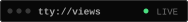

<div align="center">

<!-- ======================================================================= -->
<!-- 1. HERO BANNER — SLEEP, CODE, REPEAT                                    -->
<!-- ======================================================================= -->
<picture>
  <source media="(max-width: 768px)" srcset="./assets/mobile/hero.svg" />
  <source media="(prefers-reduced-motion: reduce)" srcset="./assets/hero-fallback.png" />
  
</picture>

<br />

<!-- ======================================================================= -->
<!-- 2. DOT-MATRIX NAME SIMULATOR & SMALL PROFILE VIEWS MONITOR              -->
<!-- ======================================================================= -->
<picture>
  <source media="(max-width: 768px)" srcset="./assets/mobile/dotmatrix-name.svg" />
  <source media="(prefers-reduced-motion: reduce)" srcset="./assets/sltynx-logo.svg" />
  
</picture><br />
<kbd><br /></kbd><br />


</div>

---

## Profile Introduction


**Name:** SltyNX  
**Bio:** `Sleeping Core`

<br clear="both" />

<div align="center">

<picture>
  <source media="(max-width: 768px)" srcset="./assets/mobile/profile-intro.svg" />
  
</picture>

<br /><br />

<!-- ======================================================================= -->
<!-- 3. TELEGRAM CONTACT BUTTON                                              -->
<!-- ======================================================================= -->
<a href="https://t.me/SltyNX_X">
  
</a>

</div>

---

<!-- ======================================================================= -->
<!-- 4. UNIFIED TERMINAL: SKILLS / TOOLS -> DEV LOG & STORY ->               -->
<!--    SIMULATED ERROR & REPAIR -> KNOWLEDGE BASE -> TRYING TO UNDERSTAND   -->
<!-- ======================================================================= -->
<div align="center">
  <picture>
    <source media="(max-width: 768px)" srcset="./assets/mobile/unified-terminal.svg" />
    
  </picture>
</div>

<details>
<summary><sub>View terminal details &amp; Knowledge Base links</sub></summary>

<br />

- [`learning-notes/`](./knowledge-base/learning-notes) — Notes on Android input views, Python scripting, and Git basics.
- [`experiments/`](./knowledge-base/experiments) — Small layout tests and terminal SVG sandboxes.
- [`project-references/`](./knowledge-base/project-references) — Gnosis Keyboard data structures and references.
- [`ideas/`](./knowledge-base/ideas) — Scratchpad for future tools once I catch up on sleep.

```text
// Skills / Tools (Beginner — Learning in Progress)
Not skilled yet, but I'm building it step by step.

// Development Log & Story
$ start-project
> opening the editor...
> thinking of an idea...
> no ideas found.
> searching for motivation...
[mascot]: ...what now?
[hint-nodes]: Claude — Sonnet | Gemini | ChatGPT
> hint received -> trying to understand... -> implementing solution...

// Simulated Error & Repair
! error: something went wrong
> diagnosis: developer confusion -> requesting assistance... -> applying fix...
✓ build successful (in this simulation)

// Trying to Understand
"When I say Ehh, ehhh, ehhhh... like for three time, don't give up on me bro, I'm trying to understand it for real."
```

</details>

---

## Current Projects

<div align="center">
  <picture>
    <source media="(max-width: 768px)" srcset="./assets/mobile/current-project.svg" />
    
  </picture>
</div>

- **Project:** Gnosis Keyboard (`In Progress`)
- **Description:** A custom Android keyboard focused on control, customization, and a better typing experience.
- **Repository:** `private currently`

---

<div align="center">
  <picture>
    <source media="(max-width: 768px)" srcset="./assets/mobile/footer.svg" />
    
  </picture>
  <p>
    <sub><strong>SLYTNX</strong> &nbsp;&bull;&nbsp; <code>sleep &bull; code &bull; create</code> &nbsp;&bull;&nbsp; Thanks for visiting! &nbsp;&bull;&nbsp; <code>Still loading...</code></sub>
  </p>
</div>
