<div align="center">

<!-- ======================================================================= -->
<!-- 1. HERO BANNER — SLEEP, CODE, REPEAT                                    -->
<!-- ======================================================================= -->
<picture>
  <source media="(prefers-reduced-motion: reduce)" srcset="./assets/hero-fallback.png" />
  
</picture>

<br />

<!-- ======================================================================= -->
<!-- 2. DOT-MATRIX NAME SIMULATOR                                            -->
<!-- ======================================================================= -->
<picture>
  <source media="(prefers-reduced-motion: reduce)" srcset="./assets/sltynx-logo.svg" />
  
</picture>

</div>

---

## Profile Introduction

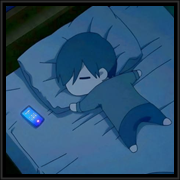

**Name:** SltyNX  
**Bio:** `Sleeping Core`

> Just a guy who sleeps a lot, codes a little, and dreams of building something cool.

> Currently a noob developer. Learning as I go, breaking things occasionally, and trying to understand how everything works.

<div align="center">

<br />

<!-- ======================================================================= -->
<!-- 3. TELEGRAM CONTACT BUTTON                                              -->
<!-- ======================================================================= -->
<a href="https://t.me/SltyNX_X">
  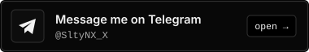
</a>

<p>
  <sub>Direct contact: <a href="https://t.me/SltyNX_X"><strong>Message me on Telegram</strong></a> (<code>@SltyNX_X</code>)</sub>
</p>

</div>

---

## Current Projects

<div align="center">
  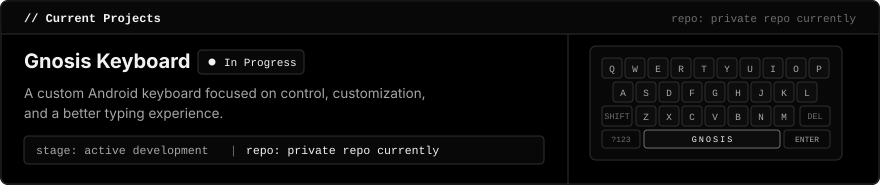
</div>

- **Project:** Gnosis Keyboard (`In Progress`)
- **Description:** A custom Android keyboard focused on control, customization, and a better typing experience.
- **Repository:** `private repo currently`

---

## Skills / Tools

**Status:** `Beginner — Learning in Progress`

<div align="center">
  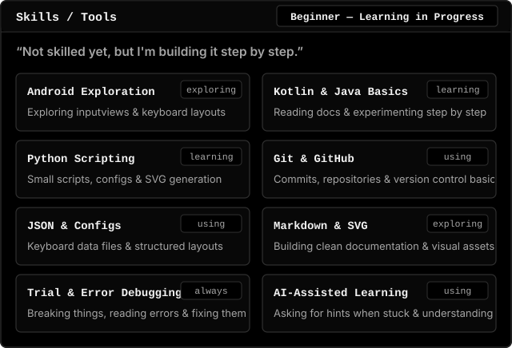
</div>

> Not skilled yet, but I'm building it step by step.

`Android (Exploring)` • `Kotlin / Java Basics (Learning)` • `Python Scripting (Learning)` • `Git & GitHub (Using)` • `JSON & Configs (Using)` • `Markdown & SVG (Exploring)`

---

## Development Log & Story

### Terminal Session — Running Out of Ideas

<div align="center">
  
  <br /><br />
  
</div>

<details>
<summary><sub>View terminal transcript (text fallback)</sub></summary>

```text
$ start-project
> opening the editor...
> thinking of an idea...
> no ideas found.
> searching for motivation...
[mascot]: ...what now?

[hint-nodes]: Claude — Sonnet | Gemini | ChatGPT
[popup]: asking for a hint... -> idea detected? -> trying again...

> hint received
> trying to understand...
> implementing solution...
```

</details>

### Simulated Error & Repair — The AI Construction Truck

<div align="center">
  
</div>

<details>
<summary><sub>View simulated error log (text fallback)</sub></summary>

```text
! error: something went wrong
> diagnosis: developer confusion
> requesting assistance...
> applying fix...
✓ build successful (in this simulation)
```

</details>

### Knowledge Base

*Notes, experiments, and things I'm learning.*

<div align="center">
  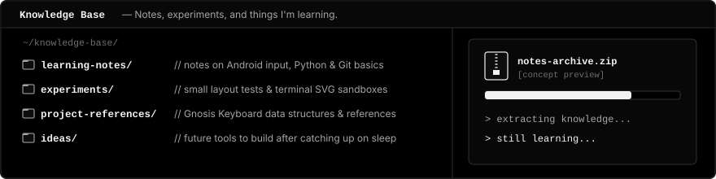
</div>

- [`learning-notes/`](./knowledge-base/learning-notes) — Notes on Android input views, Python scripting, and Git basics.
- [`experiments/`](./knowledge-base/experiments) — Small layout tests and terminal SVG sandboxes.
- [`project-references/`](./knowledge-base/project-references) — Gnosis Keyboard data structures and references.
- [`ideas/`](./knowledge-base/ideas) — Scratchpad for future tools once I catch up on sleep.

### Trying to Understand

<div align="center">
  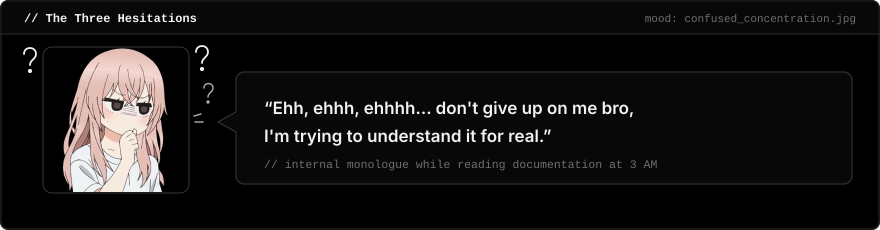
</div>

---

<div align="center">
  
  <p>
    <sub><strong>SLYTNX</strong> &nbsp;&bull;&nbsp; <code>sleep &bull; code &bull; create</code> &nbsp;&bull;&nbsp; Thanks for visiting! &nbsp;&bull;&nbsp; <code>Still loading...</code></sub>
  </p>
</div>
